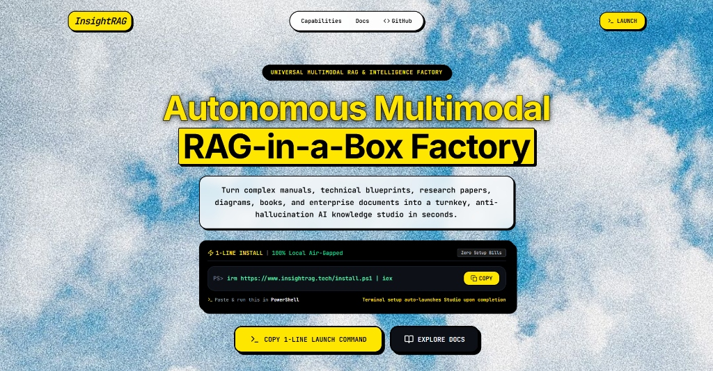

<div align="center">

# ⚡ INSIGHT • RAG
### 🧠 Universal Multimodal Document Intelligence & RAG Factory
**Zero-Budget • 100% On-Device Vector Privacy • Hardware Auto-Tuned • Multimodal Vision & ROI Diagram Cropping**

<br />
<pre align="center">
██╗███╗   ██╗███████╗██╗ ██████╗ ██╗  ██╗████████╗    ██████╗   █████╗   ██████╗ 
██║████╗  ██║██╔════╝██║██╔════╝ ██║  ██║╚══██╔══╝    ██╔══██╗ ██╔══██╗ ██╔════╝ 
██║██╔██╗ ██║███████╗██║██║  ███╗███████║   ██║       ██████╔╝ ███████║ ██║  ███╗
██║██║╚██╗██║╚════██║██║██║   ██║██╔══██║   ██║       ██╔══██╗ ██╔══██║ ██║   ██║
██║██║ ╚████║███████║██║╚██████╔╝██║  ██║   ██║       ██║  ██║ ██║  ██║ ╚██████╔╝
╚═╝╚═╝  ╚═══╝╚══════╝╚═╝ ╚═════╝ ╚═╝  ╚═╝   ╚═╝       ╚═╝  ╚═╝ ╚═╝  ╚═╝  ╚═════╝ 
</pre>

<br />

<p align="center">
  <a href="#-1-line-quickstart"><b>⚡ Quickstart</b></a> •
  <a href="#-key-capabilities--features"><b>🌟 Capabilities</b></a> •
  <a href="#-enterprise-security-hardening"><b>🛡️ Security & Hardening</b></a> •
  <a href="#%EF%B8%8F-system-architecture"><b>🏗️ Architecture</b></a> •
  <a href="https://github.com/SypherKx/InsightRAG"><b>💻 GitHub Repo</b></a>
</p>

[](https://fastapi.tiangolo.com)
[](https://react.dev)
[](https://vitejs.dev)
[](https://github.com/facebookresearch/faiss)
[](https://ollama.com)
[](https://ollama.com)
[](https://github.com/RapidAI/RapidOCR)
[](https://opensource.org/licenses/MIT)

<br />
<br />



</div>

---

## 📖 Overview

**InsightRAG AI** is an autonomous, universal multimodal Retrieval-Augmented Generation (RAG) platform. It converts complex PDF manuals, technical blueprints, scientific papers, textbooks, and enterprise data into an interactive, grounded AI knowledge studio in seconds — **with 100% on-device data privacy, zero mandatory API bills, and enterprise-grade security**.

---

## ⚡ 1-Line Quickstart

### 🪟 Windows (Universal 1-Line - Run from ANY Terminal / Directory)
Open **PowerShell** (no need to `cd` or navigate to any folder) and run:

```powershell
irm https://www.insightrag.tech/install.ps1 | iex
```

> [!TIP]
> ### ⚡ Subsequent Launches (100% Offline — No Internet Needed!)
> Once downloaded/installed, you **never need an active internet connection** or to re-run the web installer. Simply open **any PowerShell or Command Prompt** window and run:
> ```powershell
> insightrag
> ```
> **And you're good to go!** It will immediately boot all local AI pipelines and open your browser offline.

### 🖱️ 1-Click Double-Click (Local Folder)
If you downloaded/cloned the repository locally, simply double-click:
👉 **`run.bat`** in the project folder!

*What happens automatically in seconds:*
1. 🔍 **Zero-Friction Detection**: Automatically finds or sets up the project environment.
2. ⚡ **Hardware Profiling**: Detects CPU cores, RAM, and NVIDIA CUDA GPU.
3. 📦 **Self-Healing Dependencies**: Auto-verifies and installs Python + Node.js packages.
4. 🤖 **Ollama Auto-Start**: Starts local AI engine in the background.
5. 🚀 **Auto-Opens Browser**: Cleans ports and directly opens the **Live Studio** at `http://localhost:5173/app/upload`!

---

### 🐧 Linux / macOS / Manual Python Launch

```bash
# 1. Clone the repository
git clone https://github.com/SypherKx/InsightRAG.git
cd InsightRAG

# 2. Run the automated local runner
python scripts/run_local.py
```

---

## 🌟 Key Capabilities & Features

### 1. 👁️ Native Vision LLM (Moondream & Qwen2.5-VL) + RapidOCR Dual Engine
* **On-Device Vision Intelligence**: Deep visual document comprehension powered natively by lightweight local Vision LLMs (**`moondream:latest`** and **`qwen2.5vl:latest`**) via Ollama.
* **Complex Diagram & Schematic Comprehension**: Understands and reasons over system architectures, electrical schematics, flowcharts, mathematical diagrams, process cycles, and technical blueprints.
* **RapidOCR Resilient Fallback**: If documents contain low-contrast scans, rotated text, or non-searchable images lacking text layers, the pipeline automatically engages an embedded **RapidOCR** engine to extract exact textual symbols and coordinate bounding boxes.

### 2. 🎯 Targeted Visual ROI & Diagram Auto-Cropping & Fingerprinting
* **Intelligent Sub-Region Isolation**: When querying specific components (e.g., *"show me the attention mechanism diagram"* or *"Figure 3 block diagram"*), the engine scans PDF vector graphics (`fitz.get_drawings()`) and image regions to extract only the target visual asset.
* **Perceptual Visual Fingerprinting**: Extracted diagrams and sub-regions are fingerprinted with perceptual hashes (`dhash`, `phash`, MD5), preventing duplicate vectors and binding exact figures to semantic search anchors.
* **Interactive Visual Evidence Cards**: Chat answers render zoomable, high-res visual diagram cards with page attribution, crop previews, and full enlargement on click.

### 3. 🛡️ Factual Shield & Anti-Hallucination Calibration
* **Cosine Distance Gating**: Dynamically calculates semantic distance thresholds against retrieved chunks. If source evidence is weak or missing, the model deterministically triggers a zero-evidence refusal protocol rather than hallucinating answers.
* **HyDE (Hypothetical Document Embeddings)**: Generates hypothetical response vectors to bridge the vocabulary gap between short user questions and dense technical documentation.
* **Strict Source Grounding**: Enforces rigid context boundaries (`<document_context>`) ensuring answers derive exclusively from indexed pages.

### 4. 🔁 RLHF Feedback Store & Adaptive Reranking
* **Interactive Upvote/Downvote Feedback**: Users can rate retrieval responses directly in the studio chat interface.
* **On-Device SQLite Feedback Store**: Stores ratings and queries locally in `feedback_store.py` (`insightforge.db`).
* **Adaptive Reranking**: Automatically boosts highly-rated chunks and penalizes poorly aligned passages on future queries.

### 5. 📦 1-Click Local Model Hub & Background Streaming
* **Zero-Terminal Model Installation**: Pull and switch local LLMs and Vision models (`llama3.2:3b`, `moondream:latest`, `qwen2.5-coder:7b`, `mistral`) directly inside the studio UI.
* **Live SSE Progress Bars**: Real-time layer download percentages, transfer rates, and model verification streamed via Server-Sent Events.

### 6. 🔒 Air-Gapped Terminal Launcher & Studio Gating
* **Single Command Setup**: Run `irm https://www.insightrag.tech/install.ps1 | iex` from any terminal on Windows.
* **Gated Studio Workspace**: Studio is strictly locked until the terminal completes dependency setup and boots the local engine on port 8000, then automatically unlocks the workspace in your browser.
* **Global Offline Command**: Auto-registers `insightrag` command globally across Windows for 100% offline launches without internet.

### 7. 🔬 Deep Page-by-Page Multimodal Ingestion & Analysis
* **Exhaustive Document Comprehension**: Never skims or rushes. Every page is systematically inspected, extracting high-fidelity text, vector graphics, image bounding boxes, tables, and mathematical formulas.
* **Granular Visual Metadata**: Images, figures, and diagrams are tagged with their exact page coordinates (`[x0, y0, x1, y1]`) and embedded into dense vector memory with distinct context anchors.

### 8. 🖥️ Dedicated Fullscreen Chat Studio with Ingestion Gating
* **Two-Phase Workflow**: Documents first undergo thorough multi-stage ingestion with animated progress trackers (Reading Pages → Extracting Graphics → Generating Vectors → Storing in FAISS).
* **Immersive Fullscreen Workspace**: Seamlessly transitions into a dedicated fullscreen chat interface with multi-turn memory, high-res zoomable diagram previews, 1-click copy, and executive formatted markdown rendering.

### 9. 💬 Multi-Turn Conversational Memory (ChatGPT Experience)
* **Full Context Retention**: Seamlessly asks follow-up questions referencing previous answers, facts, and citations across multiple turns.
* **Persistent Sessions**: Real-time auto-synchronization to `localStorage` preserves conversations and diagram evidence even after browser exits or PC reboots.
* **Executive Markdown**: Custom rendered tables, copyable code blocks, and visual diagram badges.

### 10. 📑 Selective Page Range Slicing
* **Precision Ingestion**: Upload 1,000+ page books or manuals and choose exact page ranges (e.g., *Page 45 to 80*) to slice and index only the target chapter.
* **Zero Index Bloat**: Saves vector space and boosts retrieval speed.

### 11. ⚡ Dual Compute Architecture (Local Air-Gapped vs. Turbo Cloud)
* **💻 100% Local Mode [DEFAULT]**: Powered by local Ollama (`llama3.2:3b`, `moondream:latest`, `qwen2.5`) and `faiss-cpu`. Zero data leaves your machine.
* **⚡ Advance Turbo Server**: Accelerated cloud processing using Groq (`llama-3.3-70b-versatile`), Google Gemini (`gemini-1.5-flash`), or OpenAI (`gpt-4o-mini`).

### 12. 🧠 Speed-Tiered Dense Embeddings
* **⚡ `all-MiniLM-L6-v2` (Ultra-Fast 5x • 384-dim)**: CPU-friendly embedding inference for fast laptops.
* **⚖️ `bge-small-en-v1.5` (Balanced 3x • 384-dim)**: Top retrieval accuracy for standard desktop PCs.
* **🧠 `bge-base-en-v1.5` (High Precision • 768-dim)**: SOTA dense semantic capture for research & technical depth.
* **🚀 `nomic-embed-text` (Ollama Native 8K • 768-dim)**: High-context 8,192 token window for large book chapters.

---

## 🛡️ Enterprise Security Hardening

InsightRAG AI is audited and hardened against all major web and LLM vulnerabilities:

| Protection Area | Implementation Details |
| :--- | :--- |
| **OWASP Security Headers** | Built-in middleware appending `X-Frame-Options: DENY`, `X-Content-Type-Options: nosniff`, `Content-Security-Policy (CSP)`, `X-XSS-Protection`, `Referrer-Policy`, and `Permissions-Policy`. |
| **Path Traversal & LFI Defense** | `sanitize_filename` & `validate_safe_path` prevent directory escape (`../` and `..\\` attacks) across all upload and crop endpoints. |
| **Decompression Bomb Protection** | Pillow `Image.MAX_IMAGE_PIXELS = 25_000_000` and uncompressed XML byte-size limits on `.docx` prevent memory flooding DoS attacks. |
| **Prompt Injection Isolation** | RAG context is encapsulated within strict `<document_context>` and `<user_query>` delimiters with hardened anti-jailbreak directives. |
| **Information Disclosure Safety** | Global exception handler prevents internal server paths, database schemas, or tracebacks from leaking into network/DevTools inspect tabs. |
| **Extension Whitelisting** | Strictly enforces whitelist validation (`.pdf`, `.txt`, `.md`, `.csv`, `.docx`, `.png`, `.jpg`, `.webp`) and rejects dangerous executables (`.exe`, `.sh`, `.php`, `.bat`). |

---

## 🏗️ System Architecture

```
┌────────────────────────────────────────────────────────────────────────┐
│                        InsightRAG AI Pipeline                          │
└────────────────────────────────────────────────────────────────────────┘

 [ Documents / Scans ] ──> [ Multimodal Ingestion ] ──> [ Overlapping Chunker ]
   • PDF Manuals & Books     • PyMuPDF Drawings & Slices  • 500 chars (50 ovlp)
   • Technical Blueprints    • Moondream / Qwen2.5-VL     • Token-Aware Splitting
   • Schematics & Scans      • RapidOCR Fallback Layer
                                                                 │
                                                                 ▼
 [ User Natural Query ]                                 [ Dense Embedding Engine ]
          │                                               • all-MiniLM-L6-v2 (384d)
          ▼                                               • bge-small / bge-base
 [ Multi-Turn Memory ] ──> [ HyDE & Cosine Gating ] ────> • nomic-embed-text (8k)
                               (FAISS IndexFlatIP)               │
                                       │                         ▼
                                       ▼                 [ Vector Knowledge Base ]
                             [ Grounded RAG Prompt ]       • 100% Local FAISS Store
                             • <document_context>          • Visual Perceptual Hashes
                             • <user_query>                • RLHF Feedback Weights
                                       │
                                       ▼
                         [ Local Ollama / Turbo Cloud ]
                           • Vision: moondream / qwen2.5-vl
                           • LLM: llama3.2 / qwen2.5-coder
                           • Turbo: Groq 70B / Gemini / GPT-4o
                                       │
                                       ▼
                       [ Cited Answer + Visual Diagram Card ]
```

---

## 📂 Repository Structure & Module Architecture

```
InsightRAG/
├── backend/                              # ⚡ FastAPI High-Performance Backend & AI Engine
│   ├── main.py                           # App entrypoint, OWASP security headers, CORS & SPA mount
│   ├── config.py                         # Pydantic configuration, env variables & admin whitelists
│   ├── dependencies.py                   # Dependency injection (FileStore, RAGService, AnalysisService)
│   ├── requirements.txt                  # Python dependencies for backend & ML engines
│   ├── models/                           # Pydantic Data Contracts & Schemas
│   │   ├── requests.py                   # Request validation (RAG queries, feedback, models)
│   │   └── responses.py                  # Standardized response envelopes & schemas
│   ├── routers/                          # API Route Controllers (/api/v1)
│   │   ├── auth.py                       # User login audit, activity tracking & admin logs
│   │   ├── rag.py                        # Document ingestion, FAISS queries, streaming SSE & ROI cropping
│   │   ├── datasets.py                   # CSV/TSV uploads, schema inference & validation
│   │   ├── anomalies.py                  # Statistical anomaly endpoints & severity rankings
│   │   ├── health.py                     # Health checks & uptime monitoring
│   │   └── system.py                     # Hardware detection (CUDA/CPU), Ollama model manager
│   ├── services/                         # Business Logic & Orchestration
│   │   ├── rag_service.py                # FAISS vector store coordinator & multi-model router
│   │   ├── dataset_service.py            # File ingestion, normalization & quality scoring
│   │   └── analysis.py                   # Root-cause analysis & natural language generator
│   ├── storage/                          # Persistent Storage & Database
│   │   ├── database.py                   # SQLAlchemy ORM (datasets, anomalies, user_access_logs)
│   │   └── file_store.py                 # Multi-format local disk & cloud file storage handler
│   └── utils/                            # Security, Rate Limiting & Auth Hardening
│       ├── firebase_auth.py              # Firebase Admin SDK, ID token verification & admin RBAC
│       ├── rate_limiter.py               # In-memory sliding-window anti-DoS & brute-force protection
│       └── security.py                   # Path traversal protection & safe filename sanitization
│
├── frontend/                             # 🎨 React 19 + Vite 7 Modern Studio SPA
│   ├── src/
│   │   ├── routes/                       # TanStack File-Based Routing System
│   │   │   ├── __root.tsx                # App root shell, HTML head, query & auth providers
│   │   │   ├── index.tsx                 # Neo-Brutalist landing page, OS switcher & locked installer
│   │   │   ├── app.tsx                   # Studio Zero-Trust Auth Guard (requires sign-in)
│   │   │   ├── app.upload.tsx            # Multi-file drag-and-drop document ingestion studio
│   │   │   ├── app.query.tsx             # Fullscreen RAG chat studio with zoomable diagram cards
│   │   │   ├── app.dashboard.tsx         # Document index manager & knowledge base overview
│   │   │   ├── app.anomalies.tsx         # Anomaly detection & statistical metrics explorer
│   │   │   ├── app.anomalies.$id.tsx     # Deep-dive root-cause attribution & driver breakdown
│   │   │   ├── docs.tsx                  # Interactive documentation & API reference
│   │   │   ├── features.tsx              # Capabilities, benchmark comparisons & specifications
│   │   │   └── about.tsx                 # Architecture deep-dive & design philosophy
│   │   ├── components/                   # Component Library & Design System
│   │   │   ├── auth/                     # Authentication & Access UI
│   │   │   │   └── AuthModal.tsx         # 1-Click Google Sign-In & Email/Password popup
│   │   │   ├── brand/                    # Brand assets, vector logos & wordmarks
│   │   │   ├── dashboard/                # Studio shells, sidebar navigations & stat cards
│   │   │   ├── marketing/                # Hero visualizers, navbar, and interactive installer guides
│   │   │   ├── premium/                  # Ambient backgrounds, glass cards & glow badges
│   │   │   └── ui/                       # Accessible Shadcn/UI primitives (buttons, modals, dialogs)
│   │   ├── lib/                          # Core Client Utilities & State
│   │   │   ├── firebase.ts               # Firebase Web SDK initialization & Google Analytics
│   │   │   ├── auth-context.tsx          # User auth lifecycle, login/logout & token synchronization
│   │   │   └── utils.ts                  # ClassName merging (`clsx` + `tailwind-merge`)
│   │   ├── services/                     # HTTP API Client
│   │   │   └── api.ts                    # Axios client with automatic Bearer token interceptor
│   │   └── styles.css                    # Tailwind CSS v4 design tokens & responsive typography
│   └── package.json                      # Frontend dependencies & npm scripts
│
├── src/                                  # 🧠 Core Algorithmic & AI Engine (Library)
│   ├── rag/                              # Multimodal RAG Pipeline
│   │   ├── chunker.py                    # Token-aware sliding chunker with overlap
│   │   ├── embeddings.py                 # Dense embeddings (all-MiniLM, BGE, Nomic-Embed)
│   │   ├── vectorstore.py                # 100% on-device FAISS vector indexer
│   │   ├── image_regions.py              # Visual ROI diagram cropper & perceptual hashes
│   │   ├── anti_hallucination.py         # Cosine gating & factual shield verification
│   │   ├── feedback_store.py             # SQLite RLHF rating store for adaptive reranking
│   │   └── retriever.py                  # Hybrid dense + lexical retrieval coordinator
│   ├── ingestion/                        # Multi-Format Ingestion Pipeline
│   │   ├── parser.py                     # High-fidelity PDF, DOCX, CSV, TXT & image extractor
│   │   ├── cleaner.py                    # Text normalization, unicode repair & whitespace cleaning
│   │   └── validator.py                  # File structure, schema integrity & security validator
│   ├── detection/                        # Statistical Anomaly Detection
│   │   ├── algorithms.py                 # Z-Score, IQR, Isolation Forest & STL decomposition
│   │   ├── detector.py                   # Multi-algorithm anomaly discovery engine
│   │   └── scorer.py                     # Severity & confidence ranking algorithms
│   ├── root_cause/                       # Causal & Attribution Engine
│   │   ├── analyzer.py                   # Multi-variable driver & segment analysis
│   │   ├── correlator.py                 # Pearson & Spearman correlation matrices
│   │   └── segmenter.py                  # High-dimensional slicing & change-point locator
│   └── explainer/                        # Natural Language Explanation Generator
│       ├── generator.py                  # Structured natural language insight builder
│       └── llm_client.py                 # Local Ollama / Groq / OpenAI LLM abstraction
│
├── scripts/                              # 🛠️ Automation & Operational Scripts
│   ├── run_local.py                      # Unified local runner (boots backend, frontend & Ollama)
│   ├── benchmark_rag.py                  # Retrieval speed & accuracy latency benchmarks
│   └── generate_obsidian_vault.py        # Generates interactive Obsidian markdown vault
│
├── launch.ps1                            # ⚡ 1-Click PowerShell launcher for Windows
├── install.ps1                           # 🌐 Universal 1-line web installer
├── run.bat                               # 🖱️ 1-Click double-click Windows desktop batch runner
└── README.md                             # 📖 Master documentation & specifications
```

---

## 🧭 Developer Quick Navigation Guide (Where Do I Find X?)

For contributors and developers onboarding onto InsightRAG, here is where every key piece of functionality lives:

| What do you want to do? | Key File(s) to Inspect & Modify |
|:---|:---|
| 💬 **Customize RAG Chat UI & Diagram Cards** | [`frontend/src/routes/app.query.tsx`](frontend/src/routes/app.query.tsx) |
| 📄 **Change Document Ingestion / File Upload UI** | [`frontend/src/routes/app.upload.tsx`](frontend/src/routes/app.upload.tsx) |
| 🔐 **Modify Login / Signup Pop-up & Google Auth** | [`frontend/src/components/auth/AuthModal.tsx`](frontend/src/components/auth/AuthModal.tsx) & [`frontend/src/lib/auth-context.tsx`](frontend/src/lib/auth-context.tsx) |
| 🛡️ **Update Studio Protected Auth Guard** | [`frontend/src/routes/app.tsx`](frontend/src/routes/app.tsx) |
| 🌐 **Add / Modify HTTP API Endpoints** | [`backend/routers/`](backend/routers/) (`rag.py`, `auth.py`, `datasets.py`) |
| ⚙️ **Change Server Ports, LLMs, or Admin Whitelists** | [`backend/config.py`](backend/config.py) |
| 💾 **Modify Database Tables & Models (SQLAlchemy)** | [`backend/storage/database.py`](backend/storage/database.py) |
| 🥷 **Tweak Rate Limiting & Anti-Brute Force** | [`backend/utils/rate_limiter.py`](backend/utils/rate_limiter.py) |
| 🔍 **Tune FAISS Vector Store, Embeddings & Chunker** | [`src/rag/chunker.py`](src/rag/chunker.py), [`src/rag/vectorstore.py`](src/rag/vectorstore.py), [`src/rag/embeddings.py`](src/rag/embeddings.py) |
| 👁️ **Adjust Vision ROI Diagram Cropper & Hashing** | [`src/rag/image_regions.py`](src/rag/image_regions.py) |
| 📊 **Tweak Statistical Anomaly Detection (Z-Score/IQR)**| [`src/detection/algorithms.py`](src/detection/algorithms.py) & [`src/detection/scorer.py`](src/detection/scorer.py) |
| 🚀 **Run the Entire System Locally** | `run.bat` (Windows 1-Click) or `python scripts/run_local.py` |

---

## 🔌 REST API Reference

### 🔐 Authentication & Audit API

| Method | Endpoint | Access Level | Description |
|---|---|---|---|
| `POST` | `/api/v1/auth/record-login` | Rate-Limited | Records user sign-in events (IP, user agent, timestamp) to audit store |
| `POST` | `/api/v1/auth/track-action` | Rate-Limited | Tracks specific user actions (e.g., copying install command, document view) |
| `GET` | `/api/v1/auth/me` | Authenticated | Retrieves current verified user profile, email, and admin status |
| `GET` | `/api/v1/auth/logs` | **Admin Only** | Returns full audit trail of all users accessing the platform and code |

### 🧠 Multimodal RAG & Intelligence API

| Method | Endpoint | Description |
|---|---|---|
| `GET` | `/api/v1/health` | Server health check, uptime, and security headers status |
| `POST` | `/api/v1/rag/documents` | Upload & vectorize documents with optional `start_page`/`end_page` |
| `GET` | `/api/v1/rag/documents/{task_id}/status` | Check real-time ingestion status and progress |
| `POST` | `/api/v1/rag/query` | Grounded multi-turn RAG query with citations & visual diagram snippet |
| `POST` | `/api/v1/rag/query/stream` | Real-time SSE token streaming query response |
| `GET` | `/api/v1/rag/crop` | Dynamic sub-region diagram cropping and high-resolution rendering |
| `GET` | `/api/v1/rag/images/{doc}/{img}` | Serves extracted visual diagrams and bounding-box image assets |
| `POST` | `/api/v1/rag/feedback` | Upvote/downvote RLHF response feedback for adaptive reranking |
| `GET` | `/api/v1/rag/stats` | Retrieve indexed document vectors and file statistics |
| `POST` | `/api/v1/rag/clear` | Securely purge all documents and vector indices |
| `GET` | `/api/v1/system/specs` | Hardware profiling (CPU cores, RAM, CUDA GPU acceleration) |
| `POST` | `/api/v1/system/hardware-mode` | Dynamic toggle between CPU and CUDA GPU acceleration |
| `POST` | `/api/v1/system/pull-model` | 1-Click Ollama model downloader with live SSE layer progress |
| `GET` | `/api/v1/system/models` | List installed Ollama models on the local device |

---

## 🛠️ Environment Configuration

Create a `.env` file in the project root (optional):

```env
# RAG Configuration
RAG_ENABLED=true
EMBEDDING_MODEL=all-MiniLM-L6-v2

# Local LLM (Ollama)
LLM_PROVIDER=ollama
OLLAMA_BASE_URL=http://127.0.0.1:11434
LLM_MODEL=llama3.2:3b

# Optional: Cloud Accelerated Keys
GROQ_API_KEY=
GEMINI_API_KEY=
OPENAI_API_KEY=
```

---

## 👤 Author & Credits

Designed and built with ❤️ by **[Karan Pratap Singh](https://github.com/SypherKx)**.

Contributions and pull requests are welcome! If you find InsightRAG helpful, please star ⭐ the repository.
